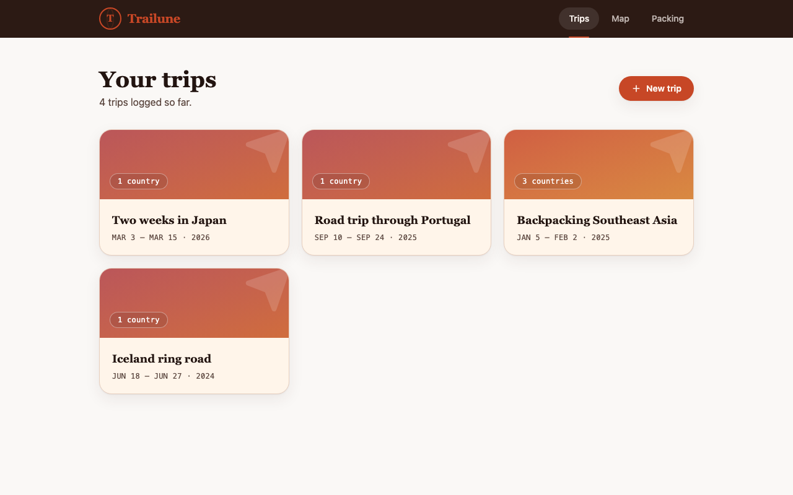
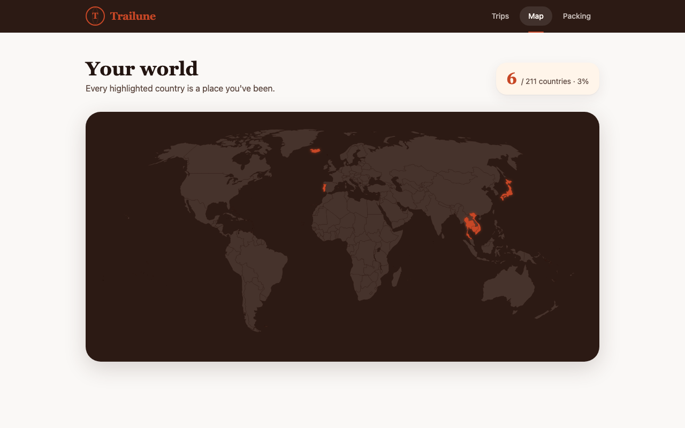
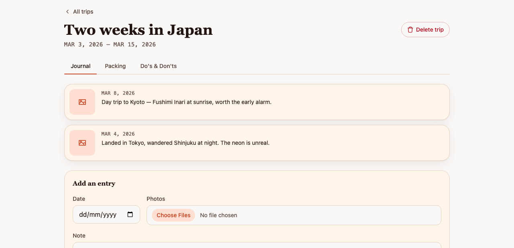

# Trailune

<p>
  
  
  
  
  
  
  <a href="https://ko-fi.com/laddtnov"></a>
</p>

**Track every journey.**

[🌐 Live demo](https://trailune.laddtnov.xyz/) · [☕ Support on Ko-fi](https://ko-fi.com/laddtnov)

Trailune is a personal travel tracker. You log trips with photo journal entries, waypoints, packing lists and local tips. The world map, timeline, calendar and stats then fill themselves in from that data. It installs as a PWA and works offline.

One thing to know up front: there's no backend and no accounts. Everything runs in your browser, with structured data in `localStorage` and photos in `IndexedDB`. The single exception is the footer feedback form, which posts to a small serverless function, because sending email needs a secret that can't sit in browser code. Multi-device sync would need a real backend, and that's planned for v2 rather than missing from v1.

## Screenshots

| Trips | World map | Trip hub |
|---|---|---|
|  |  |  |

## Table of contents

- [Screenshots](#screenshots)
- [Features](#features)
- [How it's built](#how-its-built)
- [Routes](#routes)
- [Data model](#data-model)
- [Getting started](#getting-started)
- [Testing](#testing)
- [Deploying](#deploying)
- [Project structure](#project-structure)
- [Deferred to v2](#deferred-to-v2)
- [Credits](#credits)

## Features

**Trips.** A trip has a name, a date range, the countries you visited, and a transport mode (flight, train, road, boat, other). You can filter the list by mode. Once a trip has a journal photo, its card uses the earliest one as a header image; otherwise it falls back to a mode-colored gradient. Deleting a trip takes everything under it with it, including journal entries, packing items, photos, do's and don'ts, tips and pins.

**Journal, as a diary.** Dated entries with a note, photos, and an optional 1-5 star rating, laid out like a postcard: photo on the left, date and note and stars on the right. Entries are editable and deletable. Thumbnails in the list, full-size on the entry page.

**Journey waypoints.** The Pins tab holds an ordered list of places you can drag to reorder. Once a trip has two or more pins, a route chain appears above the list (`Dublin → Doha → Sydney`). Every pin doubles as a waypoint and can carry a note.

**Photo gallery.** A Gallery tab per trip that pulls every photo from that trip's journal entries and tips into one grid, with a lightbox.

**Destination preview.** A card in the trip hub showing each visited country's currency, UTC offset, and a season and climate blurb worked out from your actual travel dates and the hemisphere. It's backed by a bundled reference table covering all 211 countries the map knows about, so no API call.

**Packing checklist.** Ticket-style cards with a category icon, a label and a rotated "PACKED" stamp, rather than plain checkbox rows. Five named templates ship with it: General, Beach Holiday, Business Trip, Camping, Winter. Picking one at trip creation copies its items into that trip, so editing a trip's list never touches the template or any other trip.

**Do's and Don'ts.** A two-column checklist per trip for the reminders and warnings you want to hand while you're there.

**Tips.** Local notes per trip, tagged by category (currency, places to avoid, transit, sightseeing), each with an optional photo.

**The Living Map.** A clickable SVG world map that highlights everywhere you've been. It's derived from trip data, so it can't fall out of sync. Newly visited countries play a one-time reveal with a scratch-card peel texture. Hover or tap a country for its stats (visit count, total days, longest stay, first and last year), click to zoom into it. Across your whole history, animated arcs connect countries in first-visit order, and a heatmap deepens a country's fill the more times you've been. A trip's own Map tab draws a flight route between just that trip's countries.

**Globe mode.** A `/globe` route with a 3D globe you can spin and zoom (Three.js and `three-globe`). Visited countries take the current theme's accent color. It uses a bundled Natural Earth boundary dataset, so it works offline like everything else.

**Dream Map.** A `/dream-map` page for countries you haven't reached yet. Rate them 1-5, add a note, and they show up on their own wishlist map and a sorted list.

**Journey timeline.** `/timeline` groups trips by year, newest first, with flags, a season badge and duration. There's a Compact view toggle that collapses each year to one line, and clicking a year jumps back into the full view at that point.

**Travel calendar.** `/calendar` is a GitHub-style yearly heatmap of travel days, each day colored by the trip it belongs to, with tooltips, a per-year legend and year navigation.

**Home dashboard and stats.** The home page opens with a greeting that knows the time of day, a stats strip and a rank progress bar (Beginner through Trailblazer, based on country count, with a level-up animation). `/stats` goes deeper: countries and continents, trips, flights, total days travelled, longest trip, average length, plus the same rank framing ("N countries until Traveler").

**Achievements.** Milestone badges on `/stats` (Explorer, Continental Traveller, Photographer, Globetrotter) that unlock as your history grows, each with a one-time reveal.

**Year in Review.** `/stats/year` has a year picker and an annual recap: countries, trips, flights, days abroad, most-visited country, longest trip, busiest month.

**Themes.** Four color themes on `/settings`: Travel Journal, Explorer Night, Golden Sunset, Polar Morning. Switching recolors everything instantly and sticks between sessions.

**Ambient details.** Two slow theme-colored gradient blobs behind the content, skeleton loaders, a passport-stamp animation when you create a trip, a paper-grain texture, page transitions, animated stat counters. All of it respects `prefers-reduced-motion`.

**Installable and offline.** It's a PWA. Install it to your home screen or desktop and it keeps working without a connection once loaded.

**Feedback.** A footer link opens a form that emails your message to me.

## How it's built

Almost everything is client-side. The feedback form is the only server call.

- **[SvelteKit](https://svelte.dev/docs/kit)** (Svelte 5 runes, TypeScript) for the shell and routing, built with `adapter-static` plus an SPA fallback so the whole thing installs and runs offline.
- **`localStorage`** for structured data (trips, journal entries, packing items, do's and don'ts, tips, pins, wishlist) through small repository modules that share a read/write pattern.
- **`IndexedDB`** via [`idb`](https://github.com/jakearchibald/idb) for photo blobs, because binary data has no business in `localStorage`.
- A **storage facade** (`src/lib/storage/storage.ts`) composes those repositories and owns the rules that cut across them: copying a packing template onto a new trip, and cascading deletes (trip, then journal entries, packing items, do's and don'ts, tips, pins, photos) so nothing gets orphaned.
- The **world map** is a bundled SVG with each country a `<path>` keyed by ISO code, so highlighting one is a CSS class toggle with no geo service in the loop. Flight-route and arc positions come from that same SVG's geometry at render time, so there's no second coordinate dataset to keep in sync. Per-country and site-wide stats (`countryStats.ts`, `tripStats.ts`, `yearInReview.ts`, `travelCalendar.ts`) are pure functions over the trip list, so nothing is stored twice.
- The **globe** uses `three` and `three-globe` with a bundled Natural Earth GeoJSON, joined to trip data by ISO alpha-2 code. Its Three.js bundle loads on demand and is deliberately left out of the service worker precache, so people who never open `/globe` don't pay for it.
- **PWA support** via `@vite-pwa/sveltekit`: generated manifest, a service worker precaching the shell, and the offline SPA fallback.
- **Feedback** posts to a standalone Vercel function (`api/feedback.ts`) that sends mail through [Resend](https://resend.com). It lives outside SvelteKit's routing because the rest of the app has no server runtime under `adapter-static`.

## Routes

| Route | Purpose |
|---|---|
| `/` | Trips list, with hero, quick stats, rank progress, mode filter, and trip creation |
| `/map` | The Living Map: reveal animations, path arcs, visit heatmap, stats popover, zoom to country |
| `/globe` | 3D globe of visited countries, drag to spin and scroll to zoom |
| `/dream-map` | Wishlist countries you haven't visited yet |
| `/timeline` | Trips grouped by year, with a Compact view toggle |
| `/calendar` | Yearly heatmap of travel days, colored per trip |
| `/stats` | Full stats breakdown, Achievements, rank banner |
| `/stats/year` | Year in Review, with a year picker |
| `/trips/[id]` | Trip hub: Journal, Gallery, Map, Pins, Packing, Tips, Do's & Don'ts |
| `/trips/[id]/entry/[entryId]` | View, edit or delete a single journal entry |
| `/packing-template` | Edit the five reusable packing templates |
| `/settings` | Pick a color theme |

## Data model

```ts
Trip          { id, name, startDate, endDate, countries: string[], transportMode, createdAt }
JournalEntry  { id, tripId, date, note, photoIds: string[], rating? }
Photo         { id, blob, thumbnailBlob, createdAt }
PackingItem   { id, tripId | null, templateId | null, category, label, checked }  // tripId: null = shared template
DoDontItem    { id, tripId, type: 'do' | 'dont', text, checked }
TipEntry      { id, tripId, category, note, photoId: string | null, createdAt }
PinEntry      { id, tripId, label, note: string | null, order, createdAt }        // ordered waypoint
WishlistEntry { id, countryCode, rating, note, createdAt }
```

## Getting started

```sh
npm install
npm run dev
```

Open the `localhost` URL it prints.

## Testing

The storage layer (repositories, the facade, pure utility functions) has a full Vitest suite. UI behavior I check by hand, since this is a small solo project.

```sh
npm run test
```

## Deploying

Trailune deploys to [Vercel](https://vercel.com) through GitHub Actions. Every push to `main` builds and promotes to production; every pull request gets a preview deployment. See [`.github/workflows/deploy.yml`](.github/workflows/deploy.yml).

## Project structure

```
src/
  lib/
    storage/       # localStorage repositories (trips, tips, checklist, pins, wishlist,
                    # map/level/achievement view state), IndexedDB photo store, storage facade
    components/    # WorldMap, Globe, CountryPopover, TripCard, PackingChecklist, DoDontList,
                    # TipsList, PinsList, PhotoGallery, DestinationPreview, DreamMap,
                    # CalendarHeatmap, StarRating, AmbientBackground, FeedbackDialog, Skeleton
    utils/         # id generation, thumbnail generation
    countries.ts   # parses the world map SVG into a { code, name } list
    continents.ts  # country-code -> continent lookup, covers every code in world-map.svg
    countryReference.ts, destinationPreview.ts  # static country data + season/climate logic
    flightRoute.ts, scratchReveal.ts, visitIntensity.ts  # map animation/rendering helpers
    globeCountries.ts  # loads and normalizes the globe's GeoJSON country data
    countryStats.ts, tripStats.ts, yearInReview.ts, travelCalendar.ts, journeyTimeline.ts
                    # pure derived-metric functions consumed by /map, /, /stats, /stats/year,
                    # /calendar, and /timeline
    packingTemplates.ts  # the five named packing template definitions
    achievements.ts, levels.ts  # derived milestone badges and the rank/level system
    mapZoom.ts     # pure viewBox-padding math backing the map's zoom-to-country
    theme.ts       # reading/writing/applying the selected color theme
    PwaRegister.svelte  # registers the service worker
  routes/          # SvelteKit pages (see Routes above)
api/
  feedback.ts      # standalone Vercel serverless function backing the feedback form
static/
  world-map.svg          # bundled flat world map
  world-countries.geojson # bundled Natural Earth boundaries, used by the globe
docs/
  ROADMAP.md         # future-ideas backlog for the app's differentiator vision
  superpowers/       # design specs + implementation plans, one pair per feature
```

## Deferred to v2

Out of scope on purpose. [`docs/ROADMAP.md`](docs/ROADMAP.md) has the fuller backlog, including everything already shipped.

- **"On this day" memories.** Surfacing a past trip on its anniversary. Needs date-matching over journal entries and pins.
- **AI Travel Summary.** A written recap after a trip ends. Blocked on a backend decision, since an LLM API key can't be called from the browser.
- **Expenses, Documents and live Weather tabs.** Budget tracking, file attachments and a weather API are three separate features wearing one bullet point. Each needs its own design pass.
- **A backend, accounts and multi-device sync.** Planned as §8 of the roadmap, and the thing that would unblock the AI summary.

A **Notes** tab (a free-form scratchpad per trip) shipped briefly and came out again on 2026-07-31. It overlapped the journal entry's note field too closely to justify its own tab. The roadmap has the full history.

## Credits

- Flat world map SVG adapted from [tomi5/visited-countries-map](https://github.com/tomi5/visited-countries-map) (MIT), itself from [Simplemaps.com](https://simplemaps.com/).
- Globe country boundaries from [Natural Earth](https://www.naturalearthdata.com/) (public domain), 110m admin-0 dataset.
- Design specs and implementation plans live in [`docs/superpowers/`](docs/superpowers/).
